<p align="center"></p>

# driveiq-cloud

DriveIQ backend — Hono on Cloudflare Workers + D1. Serverless replatform of
[ry-ops/DriveIQ](https://github.com/ry-ops/DriveIQ) (FastAPI/Docker), which
stays live as a separate, read-only-reference product. See
[`MIGRATION_PLAN.md`](./MIGRATION_PLAN.md) for the full context, confirmed
decisions, and phase breakdown.

## Phase 1 (current)

Vehicle / maintenance / reminders CRUD, backed by D1. No RAG, no file
uploads, no auth code (Cloudflare Access sits in front of the Worker at the
edge — not implemented here).

## Development

```bash
npm install
npm run dev              # wrangler dev, local D1
npx wrangler d1 migrations apply driveiq --local
```

## Deploy

Deploys via GitHub Actions on push to `main`
(`.github/workflows/deploy-worker.yml`), applying D1 migrations then running
`wrangler deploy`. Requires a `CLOUDFLARE_API_TOKEN` repo secret.

Manual deploy:

```bash
npx wrangler d1 migrations apply driveiq --remote
npx wrangler deploy
```

## Routes

- `GET /health`
- `GET/POST/PATCH /api/vehicle`, `PATCH /api/vehicle/mileage/:mileage`
- `GET/POST/PATCH/DELETE /api/maintenance`, `GET /api/maintenance/types/summary`
- `GET/POST/PATCH/DELETE /api/reminders`, `GET /api/reminders/upcoming`,
  `POST /api/reminders/:id/complete`

<!-- org-footer -->
---

<p align="center"><sub>Part of <a href="https://github.com/fabric-forge">fabric-forge</a> · built by <a href="https://github.com/ry-ops">ry-ops</a></sub></p>
